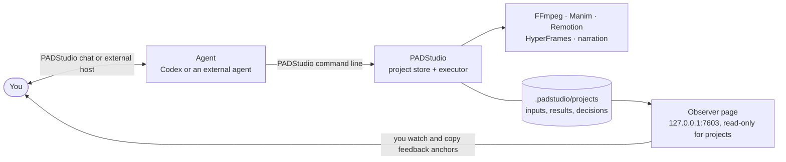

<p align="center"></p>

<h1 align="center">PADStudio</h1>
<p align="center"><strong>Precise Animated Demonstration Studio</strong><br />A video studio that runs on your machine, led by an AI Agent.</p>

<p align="center"><a href="README.md">Tiếng Việt</a> · <a href="CONTRIBUTING.md#english-summary">Contributing</a> · <a href="CHANGELOG.md">Changelog</a></p>

<p align="center"></p>

> **Language note.** PADStudio's interface and in-depth guides are in Vietnamese, and its narration, transcription and quality checks are
> tuned for Vietnamese. This page is a short English guide to what it is and how to get it running.

## Overview

You describe the video you want to an AI Agent (for example [Claude Code](https://claude.com/claude-code)). The Agent writes the script,
builds the animation, makes the voice-over, then assembles and exports the video. PADStudio is the foundation underneath: it stores
projects, runs the tools and records every input, result and piece of feedback, so a project can always be reopened and continued, even
in a new Agent session.

- **You decide.** There is no fixed pipeline. You watch, give feedback in the conversation, and accept only when you are happy.
- **Traceable.** Every file records its source, rights, the tool that made it and a checksum. The accepted video is delivered byte for byte.
- **Local.** Data stays in the project folder. Paid services (such as ElevenLabs) are always asked about first and can be capped.

## Quick start

**Requirements:** Windows 10/11, [Node.js](https://nodejs.org) 20+, [FFmpeg](https://ffmpeg.org) with `ffprobe` on `PATH`, and an Agent
that can run commands in the project folder. PADStudio has no npm dependencies, so there is no `npm install`.

**1. Clone and check your machine**

```powershell
git clone https://github.com/padduwcs/PADStudio.git
cd PADStudio
npm run padstudio:doctor
```

**2. Open the observer page** at <http://127.0.0.1:7603>

```powershell
npm run observer:ensure
```

**3. Click Trò chuyện (Chat) in PADStudio.** The built-in client uses Codex CLI on your machine. Install Codex and sign in with ChatGPT
when prompted; an existing Codex login is reused. Chat opens in the PADStudio folder, like Codex in VS Code. Send a normal prompt;
conversations are independent of the project viewer and can create or work on several video projects:

> Make a 90-second vertical video explaining why the sky is blue, narrated in Vietnamese, for middle-school students.

**4. Watch, give feedback, accept.** Choose a project in the library to watch it. To change one spot, pause there, click
**Sao chép mốc phản hồi** (*copy feedback anchor*) and paste it into your chosen conversation. When you are happy, identify the exact version,
say "accept" (in Vietnamese: "chốt") and download the accepted video.

Open several conversations at once: **New conversation** in the header creates a tab, **×** closes it, and history reopens it. Each tab keeps its own draft;
switching or closing tabs leaves agents running. Switching the viewed video project does not switch conversations. Model selection sits in the composer.
The chat follows the familiar Codex VS Code sidebar layout. Use **+** inside the composer for images/files (10 MB each) and file/skill references.
Model and reasoning controls sit on the right; mode and permissions sit on the left. The header gear contains settings, usage and shortcuts.
The **…** menu includes rename, search, fork and archive; **Thêm thao tác…** contains compact and export. Defaults inherit your Codex configuration.
Edit/retry creates a branch and preserves the original conversation; it does not undo files. History can also reopen
CLI/VS Code threads in this folder. Type `/help` for shortcuts. Chat attachments are not automatically imported into video projects.
Drag the chat divider to resize it; double-click to reset. Your chosen width is remembered. Reopening the
page never automatically resends an agent turn. Chat uses the connected Codex account's allowance. External hosts such as Claude Code
remain supported: open them in this folder, let them read [`AGENTS.md`](AGENTS.md), and use **Sao chép mốc phản hồi** to copy feedback anchors.

<p align="center"></p>

## What it can make

| Kind of video | Notes |
| --- | --- |
| **Animated explainers** (main strength) | Algorithms, maths, science, technology; 1–3 minutes; vertical 9:16, landscape 16:9 or square; narration and subtitles |
| Edits of existing footage | Cut, join, summarize, subtitles, music; automatic transcription and scene detection |
| Video from images and graphics | Gentle zoom and pan, title cards, charts, step diagrams |
| Short social videos, product demos | For social media or product introductions |

- **Animation:** Manim (formulas, geometry), Remotion (kinetic text, UI, charts), HyperFrames (frame-exact HTML/CSS).
- **Built-in styles (optional):** educational code, talking head, short form, product demo, minimal editorial.
- **Narration:** Piper (free, local) or ElevenLabs (paid; voice and model are chosen on the observer page).

## Optional tools

FFmpeg alone is enough to edit, join, subtitle and export. Everything else is optional; install it following
[`docs/CAI-DAT-RUNTIME.md`](docs/CAI-DAT-RUNTIME.md) (Vietnamese, but every command is copy-and-paste; versions are pinned and downloads
are checksum-verified):

| You want | You need |
| --- | --- |
| Remotion / HyperFrames animation | Pinned npm packages; Chrome Headless Shell for Remotion |
| Manim animation | Python 3.12 + `manim` |
| Free local narration | Piper + a Vietnamese voice model |
| Transcription and scene detection of footage | Python 3.12 + Whisper models (~5 GB) |
| ElevenLabs narration | Just an API key, pasted on the **Tools** page |

PADStudio never installs anything by itself. The **Tools** page (*Công cụ*, top of the observer page) shows what is ready and how to
enable what is missing.

<p align="center"></p>

## How it works



- **The Agent** is the only channel for commands: it understands the request and chooses the work and the tools.
- **PADStudio** stores projects, runs tools and keeps the trail. Its chat is a client for an existing agent and makes no content decisions.
- **The interface** supports chat, viewing, downloads and machine settings. Chat passes the user's prompt directly to Codex; the Agent chooses and operates projects through the CLI.

## Current limits

PADStudio is at **version 0.1** ([pre-release](https://github.com/padduwcs/PADStudio/releases/tag/v0.1.0)); `main` is always the newest.

- **Tested on Windows only.** macOS and Linux have not been tried.
- **Tuned for Vietnamese.** Narration, transcription and quality checks are tuned for it.
- **Automated checks catch technical faults only.** You still need to watch and listen for creative quality.
- **The ElevenLabs voice picker has only been tested against a simulated service.** If it behaves differently with a real account, please
  open an issue.
- **Animation code written by the Agent runs directly on your machine, without a sandbox.** See [`SECURITY.md`](SECURITY.md) (Vietnamese;
  in short: the observer listens on localhost only, API keys live in a git-ignored `padstudio.local.json`, and generated code is not isolated).

## Contributing

Contributions are welcome. Read [`CONTRIBUTING.md`](CONTRIBUTING.md) (it has an English summary at the end) and
[`CODE_OF_CONDUCT.md`](CODE_OF_CONDUCT.md) first.

```powershell
npm run check   # syntax, unused imports, links and paths in the docs (a few seconds)
npm test        # the full test suite (about a minute)
```

Report vulnerabilities privately, see [`SECURITY.md`](SECURITY.md).

## License

Source code is under the [MIT license](LICENSE), © 2026 Anh-Duc Phan. The Manrope font in `ui/fonts/` is under the SIL Open Font License
([`ui/fonts/OFL.txt`](ui/fonts/OFL.txt)). The logo and brand assets in [`ui/brand/`](ui/brand/README.md) belong to the project author; ask
before using them elsewhere. External tools (FFmpeg, Manim, Remotion, HyperFrames, Piper, Whisper, ElevenLabs) have their own licenses;
you install them yourself and are responsible for complying with them, especially when distributing videos.
