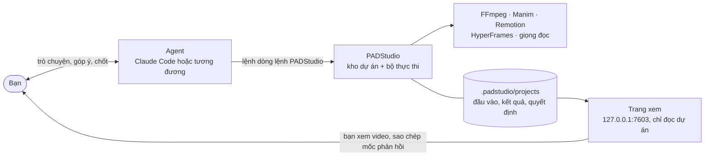

<p align="center"></p>

<h1 align="center">PADStudio</h1>
<p align="center"><strong>Precise Animated Demonstration Studio</strong><br />Xưởng làm video chạy trên máy bạn, do một Agent AI dẫn dắt.</p>

<p align="center">
  <a href="https://github.com/padduwcs/PADStudio/actions/workflows/test.yml"></a>
  <a href="LICENSE"></a>
  
  
  <a href="https://github.com/padduwcs/PADStudio/releases"></a>
</p>

<p align="center"><a href="README.en.md">English</a> · <a href="docs/HUONG-DAN.md">Hướng dẫn sử dụng</a> · <a href="docs/CAI-DAT-RUNTIME.md">Cài đặt runtime</a> · <a href="CHANGELOG.md">Lịch sử thay đổi</a></p>

<p align="center"></p>

## Giới thiệu

Bạn mô tả video mình muốn cho một Agent AI (ví dụ [Claude Code](https://claude.com/claude-code)). Agent viết kịch bản, dựng hoạt họa,
tạo giọng đọc rồi ghép và xuất video. PADStudio là phần nền bên dưới: lưu dự án, chạy công cụ và ghi lại mọi đầu vào, kết quả và phản hồi,
nên dự án luôn mở lại và làm tiếp được, kể cả khi đổi phiên Agent.

- **Bạn quyết định.** Không có quy trình cố định. Bạn xem, góp ý trong cuộc trò chuyện và chỉ chốt khi hài lòng.
- **Truy được nguồn gốc.** Mỗi file ghi nguồn, bản quyền, công cụ tạo ra và mã kiểm tra. Bản đã chốt được giao nguyên từng byte.
- **Chạy cục bộ.** Dữ liệu nằm trong thư mục dự án. Dịch vụ trả phí (như ElevenLabs) luôn được hỏi trước và có thể đặt trần chi phí.

## Bắt đầu nhanh

**Yêu cầu:** Windows 10/11, [Node.js](https://nodejs.org) 20 trở lên, [FFmpeg](https://ffmpeg.org) (kèm `ffprobe`) trong `PATH`, và một
Agent chạy được lệnh trong thư mục dự án. PADStudio không có dependency npm nên không cần `npm install`.

**1. Tải về và kiểm tra máy**

```powershell
git clone https://github.com/padduwcs/PADStudio.git
cd PADStudio
npm run padstudio:doctor
```

**2. Mở trang xem** tại <http://127.0.0.1:7603>

```powershell
npm run observer:ensure
```

**3. Mở Agent trong thư mục này** (với Claude Code: `claude`). Agent tự đọc [`AGENTS.md`](AGENTS.md) để biết cách vận hành. Sau đó
nói điều bạn muốn:

> Làm video dọc 90 giây giải thích vì sao trời có màu xanh, giọng đọc tiếng Việt, cho học sinh cấp 2.

**4. Xem, góp ý, chốt.** Bản dựng hiện trên trang xem. Muốn sửa một chỗ, dừng video tại đó, bấm **Sao chép mốc phản hồi**, dán vào
chat kèm điều bạn muốn đổi. Khi hài lòng, nói "chốt" rồi tải bản đã duyệt.

<p align="center"></p>

Hướng dẫn chi tiết từng bước và cách khắc phục sự cố: [`docs/HUONG-DAN.md`](docs/HUONG-DAN.md).

## Làm được gì

| Loại video | Ghi chú |
| --- | --- |
| **Giải thích bằng hoạt họa** (thế mạnh chính) | Thuật toán, toán, khoa học, công nghệ; 1–3 phút; dọc 9:16, ngang 16:9 hoặc vuông; lời đọc tiếng Việt và phụ đề |
| Dựng từ video quay sẵn | Cắt, ghép, tóm tắt, phụ đề, nhạc nền; tự phiên âm và tìm điểm cắt cảnh |
| Video từ ảnh và đồ họa | Zoom, di chuyển nhẹ, thẻ chữ, biểu đồ, sơ đồ các bước |
| Video ngắn, demo sản phẩm | Cho mạng xã hội hoặc giới thiệu sản phẩm |

- **Hoạt họa:** Manim (công thức, hình học), Remotion (chữ động, giao diện, biểu đồ), HyperFrames (HTML/CSS chính xác từng khung hình).
- **Phong cách có sẵn (tùy chọn):** giáo dục bằng code, người nói trước camera, video ngắn, demo sản phẩm, biên tập tối giản.
- **Giọng đọc:** Piper (miễn phí, chạy trên máy) hoặc ElevenLabs (trả phí, chọn giọng và model trên trang xem).

## Cài thêm công cụ

FFmpeg đủ để dựng, ghép, phụ đề và xuất video. Các công cụ khác là tùy chọn; cài theo
[`docs/CAI-DAT-RUNTIME.md`](docs/CAI-DAT-RUNTIME.md) (phiên bản ghim, có checksum):

| Bạn muốn | Cần cài |
| --- | --- |
| Hoạt họa Remotion / HyperFrames | Gói npm đã ghim; Chrome Headless Shell cho Remotion |
| Hoạt họa Manim | Python 3.12 + `manim` |
| Giọng đọc miễn phí | Piper + model tiếng Việt |
| Phiên âm, cắt cảnh video có sẵn | Python 3.12 + model Whisper (~5 GB) |
| Giọng đọc ElevenLabs | Chỉ cần khóa API, dán ở trang **Công cụ** |

PADStudio không tự cài gì. Trang **Công cụ** (nút ở góc trên trang xem) cho biết công cụ nào đã sẵn sàng và cách bật công cụ còn thiếu.

<p align="center"></p>

## Cách hoạt động



- **Agent** là kênh ra lệnh duy nhất: hiểu yêu cầu, chọn việc và công cụ.
- **PADStudio** lưu dự án, chạy công cụ và giữ dấu vết. Nó không có chat riêng và không tự quyết định nội dung.
- **Trang xem** để xem video, tải bản đã chốt và chỉnh cài đặt máy (khóa API, giọng). Nó không bao giờ ghi vào dự án.

## Giới hạn hiện tại

PADStudio đang ở **phiên bản 0.1** ([pre-release](https://github.com/padduwcs/PADStudio/releases/tag/v0.1.0)); nhánh `main` luôn là bản mới nhất.

- **Chỉ kiểm thử trên Windows.** macOS và Linux chưa được thử.
- **Tối ưu cho tiếng Việt.** Giọng đọc, phiên âm và kiểm tra chất lượng được chỉnh cho tiếng Việt.
- **Kiểm tra tự động chỉ bắt lỗi kỹ thuật.** Chất lượng hình ảnh và giọng đọc vẫn cần bạn xem và nghe.
- **Bộ chọn giọng ElevenLabs mới được kiểm thử với dịch vụ giả lập.** Nếu gặp sai khác với tài khoản thật, hãy mở issue.
- **Mã hoạt họa do Agent sinh ra chạy trực tiếp trên máy, không trong sandbox.** Xem [`SECURITY.md`](SECURITY.md).

## Tài liệu

**Cho người dùng**

- [`docs/HUONG-DAN.md`](docs/HUONG-DAN.md): làm video, góp ý, chốt, khắc phục sự cố
- [`docs/CAI-DAT-RUNTIME.md`](docs/CAI-DAT-RUNTIME.md): cài Manim, Remotion, HyperFrames, Piper, công cụ phân tích video
- [`docs/OPERATIONS-RUNBOOK.md`](docs/OPERATIONS-RUNBOOK.md): sao lưu, khôi phục, dọn dung lượng

**Cho Agent và người phát triển**

- [`PADSTUDIO-AGENT-RUNTIME.md`](PADSTUDIO-AGENT-RUNTIME.md): hướng dẫn vận hành cho Agent (đọc đầu tiên)
- [`PADSTUDIO-AGENT-REFERENCE.md`](PADSTUDIO-AGENT-REFERENCE.md): tra cứu lệnh và hợp đồng công cụ
- [`PADSTUDIO-REFERENCE.md`](PADSTUDIO-REFERENCE.md): tổng quan kỹ thuật, cấu trúc mã
- [`docs/build/`](docs/build/README.md): thiết kế, định hướng, [trạng thái phát triển](docs/build/PADSTUDIO-DEVELOPMENT-STATUS.md) và đặc tả

## Đóng góp

Rất hoan nghênh. Hãy đọc [`CONTRIBUTING.md`](CONTRIBUTING.md) (có phần ranh giới sản phẩm đã chốt) và
[`CODE_OF_CONDUCT.md`](CODE_OF_CONDUCT.md) trước.

```powershell
npm run check   # cú pháp, import thừa, link và đường dẫn trong tài liệu (vài giây)
npm test        # toàn bộ test (khoảng một phút)
```

Các browser test của trang xem được liệt kê trong [`CONTRIBUTING.md`](CONTRIBUTING.md). Lỗi bảo mật xin báo riêng theo
[`SECURITY.md`](SECURITY.md).

## Giấy phép

Mã nguồn theo [giấy phép MIT](LICENSE) © 2026 Anh-Duc Phan. Font Manrope trong `ui/fonts/` theo SIL Open Font License
([`ui/fonts/OFL.txt`](ui/fonts/OFL.txt)). Logo và bộ nhận diện trong [`ui/brand/`](ui/brand/README.md) thuộc về tác giả; hãy hỏi trước khi
dùng cho mục đích khác. Các công cụ bên ngoài (FFmpeg, Manim, Remotion, HyperFrames, Piper, Whisper, ElevenLabs) có giấy phép riêng; bạn
tự cài và chịu trách nhiệm tuân thủ, nhất là khi phân phối video.
